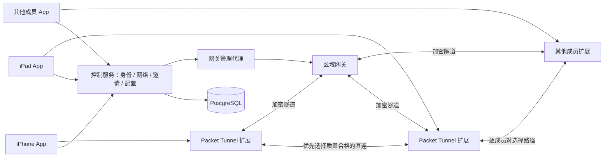
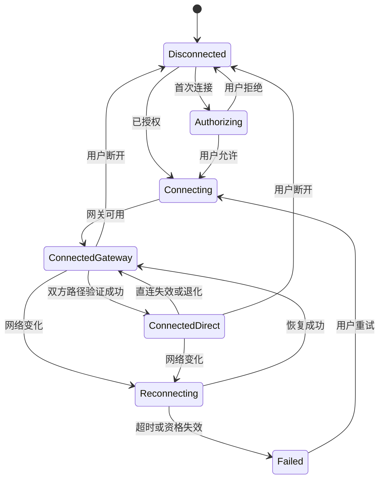

# NetPivot 产品与技术设计

版本：0.1 · 日期：2026-11-17 · 状态：待实施、待真机验证。

本文保留设计目标。查看当前网关版的实现范围、部署命令和验证记录，请从 [运行指南](RUN.md) 开始。性能数字为验收目标。

## 1. 产品定义与交付范围

NetPivot 让异地的 iPhone、iPad 获得可相互访问的虚拟 IP。用户一键创建网络，朋友通过链接、二维码或短邀请码加入，再进入游戏使用该 IP 联机。

“虚拟局域网”在本项目中指加密的三层 IP 网络，不承诺完整模拟同一 Wi-Fi 下的二层广播环境。首版提供 IPv4 单播 TCP / UDP 互通；广播、组播、Bonjour 转发、游戏房间扫描均不在首版范围内。

### 1.1 已确认与暂定条件

| 项目 | 约定 | 来源 |
| --- | --- | --- |
| 核心场景 | 星露谷异地联机，玩家自己在游戏里操作 | 用户确认 |
| 客户端 | iPhone、iPad | 用户确认 |
| 体验 | 创建和加入简单快捷 | 用户确认 |
| 产品形态 | 原生 Universal App，同一套业务逻辑、不同布局 | 设计选择 |
| 最低系统 | 暂定 iOS / iPadOS 17，开发启动时以目标设备核对 | 待实机确认 |
| 网络规模 | 每个网络最多 8 台设备，一台设备同时连接 1 个网络 | 首版设计上限；不代表游戏人数上限 |
| 身份 | 首版免注册，设备身份；后续可绑定账号恢复 | 设计选择 |
| 发行 | 先开发签名真机验证，再 TestFlight，最后评估公开上架 | 设计选择 |
| 服务地域 | 按实际玩家位置与运营商测试后选择 | 尚未指定 |

### 1.2 星露谷适配依据

官方指南说明：普通移动版提供实验性多人模式，通过 IP 加入，没有农场自动发现；Apple Arcade 的 Stardew Valley+ 不支持该模式。测试时记录双方游戏版本，按官方指南启用多人功能。[官方移动端联机指南](https://www.stardewvalley.net/mobile-multiplayer-guide/)

**设计推论**：本项目优先提供稳定的虚拟 IPv4 和复制入口，无需实现游戏发现协议。是否能通过虚拟接口实际进入农场，仍须使用目标版本的真机验证，不能仅凭隧道握手成功作结论。

第一阶段测试 iPhone ↔ iPhone、iPhone ↔ iPad、iPad ↔ iPad，双方交换主机角色。PC / Android 客户端及子网路由器属于后续扩展；仅安装本项目手机端，不会自动将未安装客户端的电脑接入网络。

### 1.3 多设备是核心能力

一个网络是多成员共享网络，不是两台设备之间的配对连接。首版设计上限为 8 台，每台有效成员可访问同网其他成员；后续可在容量、耗电和路径状态验证后调整上限。

网络管理员负责邀请和成员管理，不承担必须在线的转发职责。管理员设备离线不应导致其他成员网络中断；游戏主机离线是否中断游戏由游戏决定。某位成员加入或退出，不应改变其他成员的虚拟 IP 或重建整个网络。

多设备传输采用按成员对选路：可以同时存在直连和网关路径。8 台设备共有 28 对关系，验收必须覆盖每一对双向可达。两设备实验只是第一道关卡，不能替代多设备验收。

## 2. 用户流程：先把快捷组网做好

### 2.1 首次启动

1. 展示一句产品说明：“和朋友加入同一个网络，再去游戏里联机。”
2. 本地生成设备身份，自动命名“我的 iPhone / 我的 iPad”，允许稍后修改。
3. 首页直接展示“创建网络”和“加入网络”，不强制注册、填手机号或选择服务器。
4. 首次准备启用隧道时展示简短数据用途说明，再触发系统 VPN 配置授权；拒绝后允许重试。

设备注册和密钥生成在后台完成。授权、离线、版本不支持等错误必须立即反馈，不显示无限加载。

### 2.2 创建网络

1. 点击“创建网络”。
2. 系统生成默认网络名、网络 ID、地址段和邀请；默认名称可直接使用。
3. 自动连接；成功后进入详情，展示“已连接”、我的虚拟 IP、成员列表和“邀请朋友”。
4. 网络名、人数上限、邀请管理放在详情中，不阻挡首次创建。

首次系统授权单独计算；后续正常情况下，从首页创建到可邀请只需一次主要操作。

### 2.3 加入网络

| 方式 | 用户动作 | 行为 |
| --- | --- | --- |
| 邀请链接，优先推荐 | 点击链接 → 确认“加入并连接” | 展示网络名、邀请者设备名、当前人数；避免误入陌生网络 |
| 扫码 | 扫描 → 确认加入 | 二维码承载同一种 HTTPS 邀请链接 |
| 短邀请码 | 输入 8 位码 → 加入 | 忽略大小写和分隔符，输入完成后只需一次提交 |
| 最近网络 | 点击“连接” | 已有成员身份时无需再次输入邀请码 |

未安装 App 时链接进入简短说明页；安装后允许重新打开链接或输入同页显示的短码，不假定系统会自动恢复安装前的链接上下文。

不自动读取剪贴板。提供系统粘贴按钮和明确的“复制 IP”按钮。扫码仅在用户触发时申请相机权限。

### 2.4 进入游戏

详情页提示：“在游戏中建房；朋友加入时填写主机设备的虚拟 IP。”成员行可复制对应 IP。网络创建者与游戏主机可以是不同的人，界面不将“管理员”误标成“游戏主机”。

NetPivot 不读取农场、存档或游戏进程，也不显示未经验证的“游戏已就绪”。切换到游戏后，由 Network Extension 负责隧道；App 页面不需要保持前台。

### 2.5 邀请与成员规则

- 短码采用排除易混淆字符的 8 位编码，默认 30 分钟过期；链接包含至少 128 位随机令牌。
- 邀请默认可供多位朋友使用，但设置最大兑换次数且受网络剩余容量限制；管理员可随时关闭、刷新。
- 邀请是临时入网凭证，服务器只保存令牌哈希；访问日志、错误日志不得记录完整邀请。
- 已加入设备获得独立成员资格。邀请过期不踢出已加入成员；踢人会撤销成员资格。
- 普通操作不要求管理员逐个批准；被分享邀请的人能够加入，因此邀请页明确说明分享范围。
- 防枚举必须在服务端实现：按设备与来源限速、指数退避、统一无效/过期错误，不提供公开网络搜索。
- 可断开而保留成员资格，也可退出网络；管理员离开前转让管理权或解散网络。

## 3. 功能优先级

| 等级 | 功能 | 完成标准 |
| --- | --- | --- |
| P0 | 创建 / 加入 / 退出 / 解散 | 幂等请求、人数限制、清晰结果 |
| P0 | 链接、扫码、短码、最近网络 | 三种邀请入口归一到同一兑换流程 |
| P0 | 固定虚拟 IPv4、复制 IP、成员列表 | 重新连接保持地址；被移除后失效 |
| P0 | 加密网关转发 | 不同外网设备的游戏单播互通 |
| P0 | 双端界面、后台隧道、错误恢复 | 游戏前台运行时不依赖 NetPivot 主界面 |
| P0 | 成员隔离、撤销、权限控制 | 跨网络访问失败，撤销有界生效 |
| P1 | 直连尝试、网关回退、路径选择 | 有条件可直连，失败不阻止使用 |
| P1 | 网关备选节点、诊断、观测 | 故障能定位，切换可恢复 |
| 后续 | 账号同步、多平台、透明密文中继 | 单独设计与验收 |
| 不做 | 游戏房间扫描、修改游戏、全局上网代理 | 保持工具范围明确 |

交付分两次：**可用内测版完成 P0；正式质量版完成 P0 + P1**。不得将仅有界面的演示包称为“虚拟局域网已完成”。

## 4. 总体架构



### 4.1 技术选择

| 层 | 选择 | 原因 |
| --- | --- | --- |
| iOS / iPadOS | Swift、SwiftUI | 原生布局、系统授权和扩展集成 |
| 系统隧道 | NETunnelProviderManager + NEPacketTunnelProvider | 官方自定义 VPN 接入方式 |
| 加密协议 | WireGuard，复用 WireGuardKit / wireguard-go | 不自行设计加密握手 |
| 控制服务 | Go、标准 HTTP 路由、PostgreSQL | 单服务起步，事务处理成员和地址分配 |
| 网关 | Ubuntu 24.04 LTS、内核 WireGuard、nftables | 先用成熟组件实现可验证互联 |
| 网关管理 | 独立受限代理，本地 Unix socket 或双向 TLS | 公网 API 不持有 root 权限 |
| API | HTTPS JSON；配置快照 + 带版本的增量通知 | 简化调试并处理断线恢复 |
| 部署 | 控制服务容器化；网关直接使用宿主机网络 | 避免首版叠加容器路由复杂度 |

Apple 提供用于管理自定义 VPN 的 NETunnelProviderManager；其配置与 Packet Tunnel 扩展配套。[Apple API 文档](https://developer.apple.com/documentation/networkextension/netunnelprovidermanager)

WireGuard 使用 UDP 封装 IP 数据；密钥分发、邀请、用户与网络管理需要由本项目补齐。[WireGuard 概览](https://www.wireguard.com/)

WireGuardKit 有额外的 Go bridge 构建步骤，不能只添加 Swift Package 就假定构建完成；固定提交后按该提交说明接入。[官方 Apple 实现](https://git.zx2c4.com/wireguard-apple/about/)

### 4.2 网关信任边界

首版采用**可信网关转发**：客户端 A 到网关、网关到客户端 B 分别加密。网关会解密并转发内层 IP 包，因此具备读取未另行加密的游戏流量的技术能力。产品只能声明“传输加密”，不能宣称网关模式下端到端加密或服务器不可见内容。

直连模式在两台设备间使用 WireGuard，可避免业务包经过网关。若未来要求网关也不可解密，必须新增透明密文中继和客户端传输适配层，不能只修改隐私文案。

## 5. 地址、路由与网络隔离

### 5.1 地址分配

- 示例池：`10.203.0.0/16`，网关诊断地址 `10.203.0.1`，每个网络分配一个独立 `/24`。
- 示例网络：`10.203.1.0/24`；两台设备分别为 `10.203.1.10/32`、`10.203.1.11/32`。
- 地址池只是部署默认值，不保证永远不与真实网络冲突。建网和连接时检查可识别的路由冲突；活动对局中不偷偷重编号。
- 地址按网络和设备绑定保留；释放后至少隔离 24 小时，并确认旧租约失效再复用。
- `/16` 池不足时新增地址池及网关分片；首版不宣称无限规模。

### 5.2 路由原则

1. 客户端只把当前网络 `/24` 和网关诊断 `/32` 送入隧道。
2. 不下发 `0.0.0.0/0`，不替换系统默认 DNS；普通上网保持原路径。
3. 公网控制 API、网关公网端点不应落入隧道路由，防止套娃路由。
4. 网关每个客户端 Peer 的 AllowedIPs 严格为其分配的 `/32`，防止伪造其他成员源地址。
5. 网关防火墙仅允许同一网络中、租约有效的成员地址对互通；默认拒绝跨网络与外网转发。
6. 首版不做 SNAT / MASQUERADE；保留虚拟源 IP，便于游戏双向通信和权限检查。
7. 外层网络需要覆盖 IPv4、双栈和 IPv6-only/NAT64 测试；内层 IPv4 与外层传输能力分别验收。

WireGuard 的 AllowedIPs 同时参与发送选路和接收源地址校验，不能将其仅当作单向路由表。[Ubuntu 官方说明](https://ubuntu.com/server/docs/explanation/intro-to/wireguard-vpn/)

### 5.3 无需广播的边界

不将广播复制到其他设备，不请求无关的组播权限，不把“加入网络”描述成“所有游戏都会自动发现”。后续如果新增依赖广播的游戏，应另开兼容性设计。

Packet Tunnel 基于路由进入虚拟接口的 IP 包工作；本项目仅实现到远端网络的隧道，不将其当作任意本地代理或内容过滤器。[Apple Packet Tunnel API](https://developer.apple.com/documentation/networkextension/nepackettunnelprovider)、[Apple TN3120](https://developer.apple.com/documentation/technotes/tn3120-expected-use-cases-for-network-extension-packet-tunnel-providers)

## 6. 延迟与稳定性

### 6.1 先连通，再优化路径

连接时并行获取网关可用性与直连候选，但不长时间等待打洞。网关路径就绪后先提供连接，再探测直连。直连失败属于正常网络情况，不应显示成整个网络失败。

直连不保证总比中继快。选择路径综合考虑近段时间 RTT、丢包与抖动，避免单次最低值导致抖动切换。初始策略：候选持续优于当前路径 5 秒，且 RTT 改善超过 15 ms 或 20% 时考虑切换；切换后冷却 30 秒，故障回退不受冷却限制。参数以测试修订。

区域选择按参与设备到候选网关的路径质量综合决策，不只按创建者所在地。网络已建立后，新成员加入不立即强制所有人换节点。

### 6.2 直连实现边界

WireGuard 本身不提供完整的 NAT 候选收集和打洞服务。P1 增加控制信令、候选收集、连接检查；可以借鉴 ICE 的候选检查机制，但不把自定义简化协议称为完整 ICE 实现。[IETF RFC 8445](https://www.rfc-editor.org/rfc/rfc8445)

必须验证打洞探测与实际 WireGuard 数据使用同一有效 UDP 映射；另开一个 STUN socket 得到的公网端口，不能直接假定适用于 WireGuard。优先从现有 Go UDP bind 接口做受控扩展，固定上游提交并记录维护差异。此项是独立技术关卡，不是 SwiftUI 页面任务。

网关 Peer 使用网络 `/24`，直连 Peer 使用远端 `/32`。切换前两端完成路径验证，使用版本号、确认消息和超时回滚协调 AllowedIPs 更新。由于接收校验也会变化，混合路径期间网关转发的包可能被拒绝；不能保证无损切换。任一端未确认时回到双方网关配置。

### 6.3 连接生命周期



扩展是隧道状态的事实来源；UI 不能因为已写入配置就显示已连接。路径状态和成员状态分开：在线不代表游戏已启动，直连/网关也可能因成员而异。

### 6.4 恢复与资源策略

- Wi-Fi / 蜂窝切换：保留内层 IP，更新外层端点，重新验证路径；必要时回网关。
- App 后台：会话维持与必要配置更新由扩展完成，不依赖主 App 的定时器。
- 心跳：已有游戏流量时避免额外高频探测；需要保持 NAT 映射时可从 25 秒间隔开始测试，再按耗电和网络行为调优。[WireGuard Keepalive 说明](https://www.wireguard.com/quickstart/)
- 重试：1、2、4、8 秒退避，之后最高 30 秒并加入随机抖动；用户主动断开后停止重试。
- MTU：从 1280 的内层 MTU 开始测量，验证大包、路径 MTU 与 ICMP 行为；不可将其当作所有路径的绝对安全值。
- 实时 UDP：不在隧道层对业务包做无界重传或长队列缓存；短队列防止旧游戏包积压。
- UDP 被完全封锁：首版明确报告受限，不将 TCP 套 UDP 当作默认低延迟方案；后续可单独增加受限网络回退。
- 关闭屏幕、切走游戏、来电可能影响游戏自身。隧道恢复不等于游戏会话恢复，不承诺主机游戏后台持续运行。

### 6.5 性能验收目标

以下是初始工程目标，需要在记录的设备、运营商、节点和负载下验证。

| 指标 | 目标 | 测量口径 |
| --- | --- | --- |
| 创建网络 API | P95 ≤ 1 秒 | 服务已预热，排除用户操作时间 |
| 加入到隧道可用 | P95 ≤ 5 秒 | 排除首次授权，正常可达网络，至少 100 次 |
| 路径额外 RTT | P95 ≤ 15 ms | 与同一外层路径、相近包长和负载的基线比较 |
| Wi-Fi / 蜂窝切换 | P95 ≤ 8 秒恢复隧道收发 | 从新网络可用开始计时，不等于游戏恢复 |
| 稳态隧道丢包增量 | ≤ 0.5 个百分点 | 30 分钟，和基础路径丢包分别记录 |
| 连续游戏 | 2 小时无 NetPivot 导致的断连 | 每类设备组合至少 3 次，保留日志证据 |
| 服务可用性 | 正式运营目标 99.9% / 月 | 需备份节点与实际观测，单机内测不承诺 |

端到端总延迟受距离和运营商影响，不设“全国固定 20 ms”一类无法保证的承诺。界面仅在真实测得时展示“到某设备的 RTT”；节点探测必须标为“到节点”，没有端到端数据时显示“暂无测量”。

## 7. 服务端数据模型与 API 契约

### 7.1 数据模型

| 表 | 关键字段与约束 |
| --- | --- |
| devices | id、身份公钥、名称、创建时间、撤销状态；身份与 WireGuard 密钥用途分离 |
| networks | id、name、owner_device_id、cidr、gateway_id、capacity、revision、status |
| memberships | network_id、device_id、virtual_ip、wg_public_key、role、status；网络设备组合唯一，IP 唯一 |
| invitations | id、network_id、token_hash、code_hash、expires_at、max_uses、used_count、revoked_at |
| sessions | device_id、network_id、lease_id、expires_at、config_revision、last_seen |
| gateways | id、region、endpoint、public_key、health、capacity |
| audit_events | 操作人、动作、目标 ID、时间、结果；不含私钥、完整邀请码或游戏内容 |

兑换邀请、增加成员、分配地址、增加使用次数必须在同一数据库事务内；并发兑换不能突破容量。创建网络后配置状态先为 provisioning，网关确认应用成功才返回 ready。

### 7.2 接口清单

统一前缀 `/v1`，身份鉴权与成员授权由服务端执行；ID 不等于授权。

| 方法 / 路径 | 用途 | 主要要求 |
| --- | --- | --- |
| POST /devices | 建立匿名设备身份 | 新设备注册限速；设备证明持有身份私钥 |
| POST /auth/challenges | 获取短期随机挑战 | 防重放，挑战单次使用 |
| POST /sessions | 签名挑战换访问令牌 | 短期令牌，绑定设备；不接受客户端自称的权限 |
| GET /networks | 列出自己的网络 | 不可搜索其他网络 |
| POST /networks | 创建并加入网络 | Idempotency-Key；自动选址和节点 |
| POST /networks/{id}/invitations | 生成邀请 | 管理员权限 |
| POST /invitations/resolve | 获取最少邀请信息 | 令牌放请求体；短码限速 |
| POST /invitations/redeem | 兑换并分配虚拟 IP | 幂等、事务、容量限制 |
| POST /networks/{id}/connect | 获取会话与配置 | 校验资格、返回租约和完整快照 |
| POST /leases/{id}/renew | 续租 | 扩展可调用；校验撤销状态 |
| GET /networks/{id}/config | 拉取配置快照 | 支持 revision / ETag |
| GET /events | 成员与配置更新流 | 断线后重拉快照，不依赖永久在线流 |
| DELETE /networks/{id}/members/{deviceId} | 移除或退出 | 角色校验；撤销配置和网关权限 |
| DELETE /networks/{id} | 解散 | 幂等；先撤销再延迟清理地址 |

统一错误体：`{ "code": "INVITE_UNAVAILABLE", "message": "邀请已失效，请让朋友重新分享", "request_id": "…", "retryable": false }`。至少区分认证过期、网络满员、被移除、配置冲突、服务暂不可用、网关不可用。

### 7.3 配置快照示例

```json
{
  "schema_version": 1,
  "network_id": "net_example",
  "revision": 12,
  "lease_id": "lease_example",
  "lease_expires_at": "2026-11-17T12:05:00Z",
  "self": { "address": "10.203.1.10/32" },
  "routes": ["10.203.1.0/24", "10.203.0.1/32"],
  "mtu": 1280,
  "gateway": {
    "endpoint": "vpn.example.com:51820",
    "public_key": "REPLACE_WITH_GATEWAY_PUBLIC_KEY",
    "allowed_ips": ["10.203.1.0/24", "10.203.0.1/32"]
  },
  "peers": [
    { "device_id": "device_b", "address": "10.203.1.11/32", "public_key": "REPLACE_WITH_PEER_PUBLIC_KEY" }
  ],
  "mode": "gateway"
}
```

域名、公钥和时间均为示例，不能直接用于部署。服务器不下发客户端私钥。客户端拒绝默认路由、越界地址、过期租约、未知 schema 和倒退 revision。

### 7.4 撤销与控制面失联

初始租约 5 分钟，每 60 秒尝试续租。服务正常时撤销目标为 10 秒内；控制面失联时，已有会话最多运行到当前租约到期。到期后扩展关闭成员通信，网关代理也独立清理过期许可。

因此系统不宣称“控制服务器断网后可以永久联机”。短租约、撤销速度与离线连续性存在取舍，首版选择有界撤销。直连成员也必须应用同样的租约逻辑。

## 8. iPhone / iPad UI 设计

### 8.1 信息结构

- 网络：首页、最近网络、创建 / 加入入口。
- 网络详情：连接状态、我的 IP、成员 IP、邀请、断开。
- 诊断：当前路径、节点、测量时间、错误建议、用户主动导出日志。
- 设置：设备名称、帮助、隐私说明、清理设备身份。

首屏避免出现 MTU、NAT、AllowedIPs 等开发术语；高级诊断中再解释。直连显示“设备直连”，网关显示“通过节点连接”。

### 8.2 布局规则

| 场景 | 布局 | 操作 |
| --- | --- | --- |
| iPhone 竖屏 | 底部导航 + 单列列表，详情独立页面 | 主要按钮位于易触区域，IP 一键复制 |
| iPhone 横屏 | 保持紧凑导航，压缩装饰区域，内容可滚动 | 不强行套用平板三栏 |
| iPad 宽窗口 | NavigationSplitView：网络侧栏 + 详情 | 同时查看网络与成员，不放大手机页面 |
| iPad 更宽窗口 | 详情中并列成员与诊断卡片 | 信息宽度受限，避免文字横跨全屏 |
| iPad 窄窗口 / 分屏 | 折叠为单列导航 | 保留选中网络、滚动位置和输入内容 |
| 大字体 | 按钮与卡片允许增高，横向操作改纵向 | 不截断 IP、错误信息和主要按钮 |

依据当前 size class 与可用宽度适配，而非仅判断“是不是 iPad”。Apple 的布局指导也要求处理窗口调整、方向和文字尺寸变化。[Apple Layout](https://developer.apple.com/design/human-interface-guidelines/layout)

项目布局初值：紧凑边距 16 pt、宽布局 24 pt，触控区域至少 44×44 pt；卡片圆角 16 pt；这些是项目设计值，可经真机调整。颜色使用系统语义色，支持深浅模式；状态同时提供文字和图标，不只用红绿区分。

### 8.3 界面草图

```text
iPhone 网络详情                    iPad 宽窗口
┌────────────────────────┐        ┌──────────────┬─────────────────────────────┐
│ ‹ 网络      周末农场  ···│        │ NetPivot     │ 周末农场       已连接       │
│ ● 已连接 · 通过节点连接 │        │              │ 我的 IP 10.203.1.10 [复制]  │
│ 我的 IP 10.203.1.10 复制│        │ + 创建网络   │ [邀请朋友]          [断开]  │
│ [邀请朋友]             │        │   加入网络   ├─────────────────┬───────────┤
│ 成员                   │        │              │ 成员            │ 连接详情  │
│ 我的 iPhone       本机 │        │ ● 周末农场   │ 我的 iPhone     │ 当前节点  │
│ 朋友的 iPad   IP [复制]│        │   最近网络   │ 朋友的 iPad     │ 路径状态  │
│ 去游戏里填写主机 IP    │        │              │ IP [复制]       │ 测量时间  │
│ [断开连接]             │        │ 设置 / 帮助  │                 │           │
└────────────────────────┘        └──────────────┴─────────────────┴───────────┘
```

连接状态、邀请过期、网络满员、被移除、VPN 授权拒绝、节点失效、系统 VPN 冲突均须有明确页面状态与下一步按钮。

## 9. 安全、隐私与发行

- 设备身份私钥与 WireGuard 私钥保存在 Keychain，按需允许扩展访问；普通偏好文件不保存私钥。
- App Group 只存最小共享配置、状态及短日志；跨进程配置使用原子替换和 revision。
- 管理 API 不公开任意执行 shell 的能力，参数只允许既定地址池、合法公钥、明确网络 ID。
- 网关只允许同网有效成员互访；邀请页应让用户知道加入后会向成员开放虚拟网络访问。
- 日志默认不采集包内容、访问网站、完整 IP 列表或长期活动轨迹；诊断包先展示收集范围，用户主动导出。
- 注册、邀请兑换、建网均有限额；网关设置带宽和包速率保护，不能成为开放转发器。
- 本地网络权限按真实使用申请。游戏自身的本地网络权限由用户在游戏侧授权，NetPivot 不能代为授予。[Apple TN3179](https://developer.apple.com/documentation/technotes/tn3179-understanding-local-network-privacy)
- App Store VPN 规则包含组织开发者、数据用途披露及适用地区要求。公开发行前依照当时规则核对，不以“游戏工具”名称推定豁免。[App Review Guidelines 5.4](https://developer.apple.com/app-store/review/guidelines/#vpn-apps)

## 10. 实施与决策关卡

| 阶段 | 产物 | 进入下一阶段的条件 |
| --- | --- | --- |
| M0 | 环境清单、两台设备、固定依赖记录 | 能签名运行最小 Packet Tunnel |
| M1 | 手工 WireGuard 网关 + 两台真机 | 星露谷通过虚拟 IP 真正加入并游玩 |
| M2 | 控制 API、邀请、事务与网关代理 | 无需人工改配置即可让测试客户端入网 |
| M3 | iPhone / iPad App + 扩展 | 创建/加入/断开/后台/布局通过 P0 验收 |
| M4 | 直连与回退、备选节点 | NAT、切网、回退与成员撤销通过测试 |
| M5 | 签名内测包、运维与恢复记录 | 完成验收表并记录尚未支持的条件 |

工期不能仅由功能列表确定；M1 与 M4 是主要不确定项。应在 M1 通过后依据人员和设备情况估算，避免先给出无法依据的上线日期。

**禁止跳过的关卡**：如果隧道互通但目标游戏不能加入，先定位版本、权限、监听地址与游戏行为；在证明目标场景成立前，不继续投入完整 UI 和商业化功能。

详细步骤见 [搭建指南](BUILD_GUIDE.md)，验证记录见 [验收清单](ACCEPTANCE.md)。
